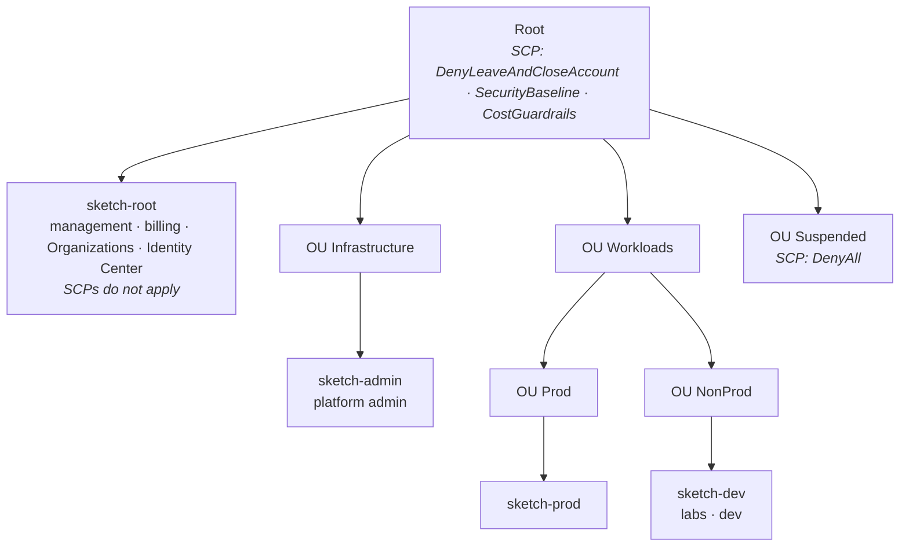

# sketch-infra

Multi-account AWS landing zone as code: AWS Organizations, layered SCP guardrails,
IAM Identity Center access matrix and remote state — all in Terraform, changed only through pull requests.

> A personal lab that reproduces an enterprise multi-account pattern end to end.

## Architecture

## Guardrails (SCP)

| Policy | Attached to | What it denies |
|---|---|---|
| `DenyLeaveAndCloseAccount` | Root | leaving the organization, closing an account |
| `SecurityBaseline` | Root | regions other than eu-central-1 / us-east-1 (global services exempt), stopping CloudTrail / GuardDuty, IAM users and access keys |
| `CostGuardrails` | Root | GPU, bare metal and very large EC2 instance types |
| `DenyAll` | Suspended | everything (quarantine before closure) |

Effective permissions = IAM permission set ∩ SCPs. Verified with `ec2 run-instances --dry-run`.

## Access matrix (IAM Identity Center)

| Group | sketch-root | sketch-admin | sketch-dev | sketch-prod |
|---|---|---|---|---|
| OrgAdmins | Admin | – | – | – |
| PlatformAdmins | ReadOnly | Admin | Admin | – |
| Developers | – | – | PowerUser | ReadOnly |
| Auditors | ReadOnly | ReadOnly | ReadOnly | ReadOnly |

Access is granted to groups only. Humans are read-only in prod; changes there go through CI/CD.

## Repository layout

| Path | Stack | State key |
|---|---|---|
| `bootstrap/` | state bucket (versioned, SSE-S3, S3-native locking) | `bootstrap/terraform.tfstate` |
| `org/` | OUs, SCPs, accounts | `org/terraform.tfstate` |
| `identity/` | groups, permission sets, account assignments | `identity/terraform.tfstate` |
| `ci/` | GitHub Actions OIDC provider and CI roles (sketch-admin → sketch-root); applied manually, never by CI | `ci/terraform.tfstate` |
| `policies/` | SCP documents (JSON) | — |
| `backend.hcl` | shared backend settings (bucket, region, locking); each stack keeps only its `key` | — |
| `.github/workflows/terraform.yml` | plan for `org/` and `identity/` on every PR via [prohres/ci-templates](https://github.com/prohres/ci-templates) | — |

## Workflow

1. Branch from `develop` (protected: PR required, no force push).
2. Credentials: `aws sso login --sso-session sketch` and `export AWS_PROFILE=sketch-root`.
3. `terraform init -backend-config=../backend.hcl` in the stack directory.
4. `terraform plan -out=<stack>.tfplan` — review adds / changes / destroys.
5. `terraform apply <stack>.tfplan` — apply exactly the reviewed plan.
6. Follow-up `terraform plan` must show *No changes*; open the PR — CI posts its own plan per stack as a comment.

## Design decisions

| Decision | Why |
|---|---|
| Plain Terraform instead of Control Tower / AFT | to own and understand every layer; in a company I would start from Control Tower |
| Management account holds no workloads | SCPs never apply to it |
| Baseline SCPs on Root, grouped by level | every new account is protected immediately; SCP quota is 5 per target |
| `aws_organizations_organization` read via data source only | an apply could drop service access principals (Identity Center) |
| Separate state per stack | smaller blast radius |
| Identity stack reads accounts from Organizations, not from the org state | stacks stay independent |
| S3 `use_lockfile` instead of DynamoDB | native locking since Terraform 1.10, DynamoDB locking is deprecated |
| Manual resources adopted with `import {}`, restructuring via expand → contract | zero-diff adoption and no window without guardrails |
| No AWS profile in code | credentials come from the environment (`AWS_PROFILE` locally, OIDC role in CI); `allowed_account_ids` still pins the target account |
| CI identity in `sketch-admin`, two-hop role chain into the management account | the management account trusts one narrow role per action; the OIDC `sub` pins PRs and develop to plan, the `prod` environment to apply |
| CI writes only the `org/` and `identity/` state | CI can't change its own trust roots (`ci/`) or the state bucket (`bootstrap/`) |
| Partial backend config (`backend.hcl`) | backend blocks can't use variables; bucket, region and locking live in one file, used the same way locally and in CI |

## Roadmap

- [ ] Delegated administration from `sketch-admin`, cross-account roles for Terraform
- [ ] CI: plan on PR, apply after merge (GitHub Actions + OIDC)
- [ ] OU Security: log-archive and audit accounts, organization CloudTrail, GuardDuty
- [ ] OU Policy Staging for testing SCPs
- [ ] Break-glass access to prod
