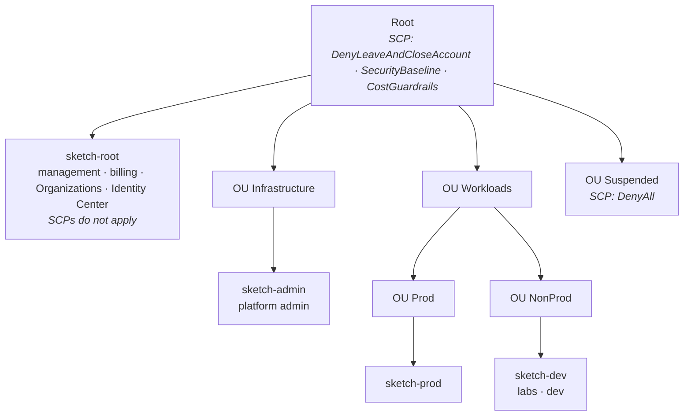

# sketch-infra

Multi-account AWS landing zone as code: AWS Organizations, layered SCP guardrails,
IAM Identity Center access matrix and remote state — all in Terraform, changed only through pull requests.

> A personal lab that reproduces an enterprise multi-account pattern end to end.

## Architecture

## Guardrails (SCP)

| Policy | Attached to | What it denies |
|---|---|---|
| `DenyLeaveAndCloseAccount` | Root | leaving the organization, closing an account |
| `SecurityBaseline` | Root | regions other than eu-central-1 / us-east-1 (global services exempt), stopping CloudTrail / GuardDuty, IAM users and access keys |
| `CostGuardrails` | Root | GPU, bare metal and very large EC2 instance types |
| `DenyAll` | Suspended | everything (quarantine before closure) |

Effective permissions = IAM permission set ∩ SCPs. Verified with `ec2 run-instances --dry-run`.

## Access matrix (IAM Identity Center)

| Group | sketch-root | sketch-admin | sketch-dev | sketch-prod |
|---|---|---|---|---|
| OrgAdmins | Admin | – | – | – |
| PlatformAdmins | ReadOnly | Admin | Admin | – |
| Developers | – | – | PowerUser | ReadOnly |
| Auditors | ReadOnly | ReadOnly | ReadOnly | ReadOnly |

Access is granted to groups only. Humans are read-only in prod; changes there go through CI/CD.

## Repository layout

| Path | Stack | State key |
|---|---|---|
| `bootstrap/` | state bucket (versioned, SSE-S3, S3-native locking) | `bootstrap/terraform.tfstate` |
| `org/` | OUs, SCPs, accounts | `org/terraform.tfstate` |
| `identity/` | groups, permission sets, account assignments | `identity/terraform.tfstate` |
| `ci/` | GitHub Actions OIDC provider and CI roles (sketch-admin → sketch-root); applied manually, never by CI | `ci/terraform.tfstate` |
| `policies/` | SCP documents (JSON) | — |
| `backend.hcl` | shared backend settings (bucket, region, locking); each stack keeps only its `key` | — |
| `.github/workflows/terraform.yml` | plan for `org/` and `identity/` on every PR via [prohres/ci-templates](https://github.com/prohres/ci-templates) | — |
| `.github/workflows/terraform-apply.yml` | after merge: plan → approval in `prod` → apply the saved plan, for `org/` and `identity/` | — |

## Workflow

1. Branch from `develop` (protected: PR required, no force push).
2. Credentials: `aws sso login --sso-session sketch` and `export AWS_PROFILE=sketch-root`.
3. `terraform init -backend-config=../backend.hcl` in the stack directory.
4. `terraform plan -out=<stack>.tfplan` — review adds / changes / destroys.
5. Open the PR — CI runs tflint and checkov (no cloud access), plans only the stacks the PR changed and posts
   the plan per stack as a comment; `plan / terraform-ok` is the required check.
6. `org/`, `identity/`: after merge CI plans the merged commit, waits for approval in the `prod` environment
   (plan in the job summary), applies exactly that plan and checks that a follow-up plan is clean.
7. `bootstrap/`, `ci/` (manual only): `terraform apply <stack>.tfplan` before the PR, follow-up plan must show *No changes*.
8. Daily drift check (`org/`, `identity/`): a drifted stack gets a "Drift detected: <stack>" issue; fix by apply or by changing the code.

## Accounts

Lightweight account vending with an AFT-style request flow: a pull request is the account request,
the pipeline creates the account, and access comes from the identity stack.

One-time setup (management account, by hand):
- Private email template: one line with an `{account}` placeholder at
  `s3://sketch-tfstate-183691668268/config/account-email-template.txt` (`--content-type text/plain`).
  It is not in git; if lost, write it again from the same rule.
- Centralized root access: `aws organizations enable-aws-service-access --service-principal iam.amazonaws.com`,
  `aws iam enable-organizations-root-credentials-management`, `aws iam enable-organizations-root-sessions`.

Add an account (one per PR: parallel CreateAccount requests can hit the in-progress limit):
1. `org/`: add a line to `local.accounts` (name + OU) → PR → plan → approval → apply.
2. `identity/`: add the account to `access_matrix` in a second PR (the identity stack plans against
   Organizations, so the account must exist first).

Remove an account:
1. `identity/`: drop its assignments.
2. `org/`: move the name from `local.accounts` to `local.closing_accounts` with a `moved {}` block →
   apply moves it to Suspended (DenyAll SCP).
3. `org/`: delete the name from `local.closing_accounts` → apply closes the account (`CloseAccount`).
   A closed account's email can't be reused, so neither can its name; it counts toward the account
   quota for 90 days.

## Design decisions

| Decision | Why |
|---|---|
| Plain Terraform instead of Control Tower / AFT | to own and understand every layer; in a company I would start from Control Tower |
| Management account holds no workloads | SCPs never apply to it |
| Baseline SCPs on Root, grouped by level | every new account is protected immediately; SCP quota is 5 per target |
| `aws_organizations_organization` read via data source only | an apply could drop service access principals (Identity Center) |
| Separate state per stack | smaller blast radius |
| Identity stack reads accounts from Organizations, not from the org state | stacks stay independent |
| S3 `use_lockfile` instead of DynamoDB | native locking since Terraform 1.10, DynamoDB locking is deprecated |
| Manual resources adopted with `import {}`, restructuring via expand → contract | zero-diff adoption and no window without guardrails |
| No AWS profile in code | credentials come from the environment (`AWS_PROFILE` locally, OIDC role in CI); `allowed_account_ids` still pins the target account |
| CI identity in `sketch-admin`, two-hop role chain into the management account | the management account trusts one narrow role per action; the OIDC `sub` pins PRs and develop to plan, the `prod` environment to apply |
| CI writes only the `org/` and `identity/` state | CI can't change its own trust roots (`ci/`) or the state bucket (`bootstrap/`) |
| Partial backend config (`backend.hcl`) | backend blocks can't use variables; bucket, region and locking live in one file, used the same way locally and in CI |
| Saved plans in a private S3 bucket (`ci/`), not GitHub artifacts | a plan file holds values in clear text and artifacts of a public repo are downloadable by anyone; 7-day lifecycle, TLS only |
| Static checks (tflint, checkov) in a job without AWS credentials; repo-wide skips in `.checkov.yaml`, per-resource skips inline with a reason | linters and their dependencies never see AWS credentials; every finding is fixed or skipped with a written reason, never silently ignored |
| Drift check: full plan (not `-refresh-only`), no auto-apply, issue holds resource addresses only | catches manual changes and merged-but-unapplied code; drift may be a deliberate hotfix, so a human decides; issues of a public repo are public, the full plan stays in the job summary |
| Plan only changed stacks (`<stack>/`, plus `policies/` for `org`; shared files plan all), one aggregator required check `plan / terraform-ok` | no AWS calls for unrelated changes; a skipped workflow (`paths:`) or skipped job would leave a required check waiting forever |
| Root emails from a private one-line template in the state bucket, checked by preconditions | adding an account is one line of code; the address is never in git or CI secrets; a wrong template fails the plan with a message that names the account, not the address, before an email change could replace (close) an account |
| Centralized root access, enabled by hand | new member accounts have no root credentials, so knowing a root email is no way in |

## Roadmap

- [ ] Delegated administration from `sketch-admin`, cross-account roles for Terraform
- [x] CI: plan on PR, apply after merge (GitHub Actions + OIDC)
- [x] Static checks (tflint, checkov), daily drift detection, plan only changed stacks
- [ ] OU Security: log-archive and audit accounts, organization CloudTrail, GuardDuty
- [ ] OU Policy Staging for testing SCPs
- [ ] Break-glass access to prod
